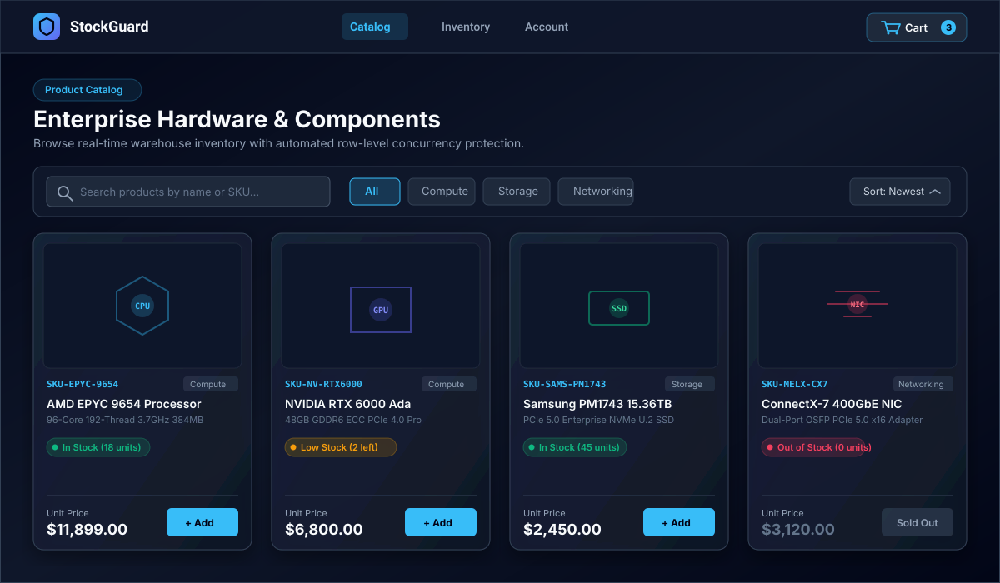
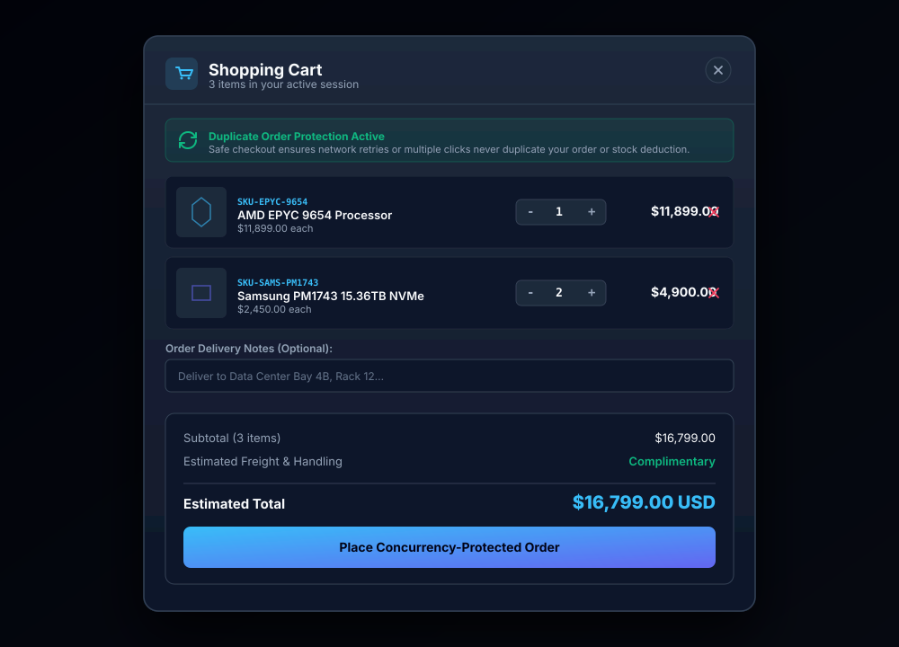
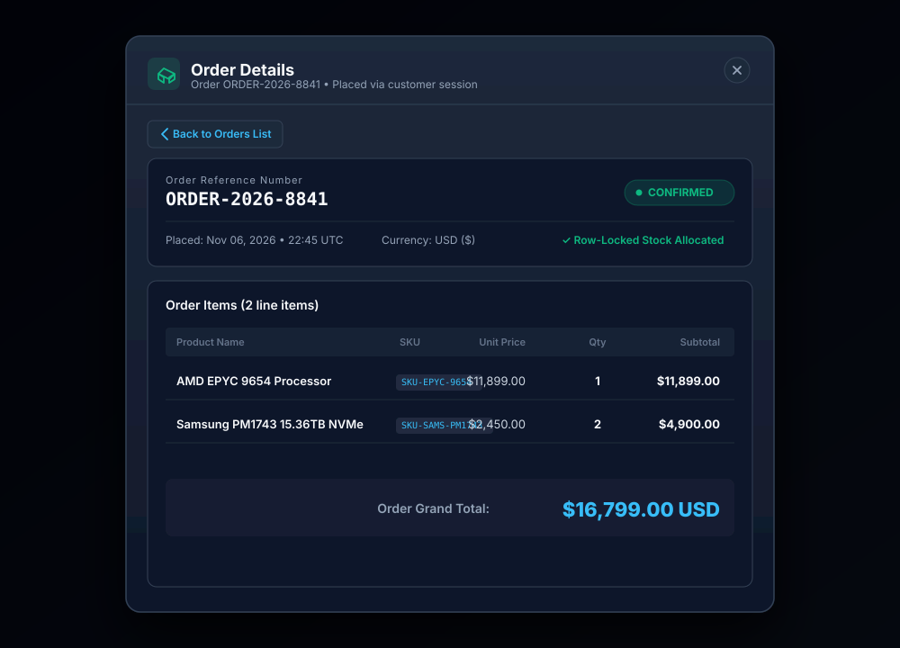
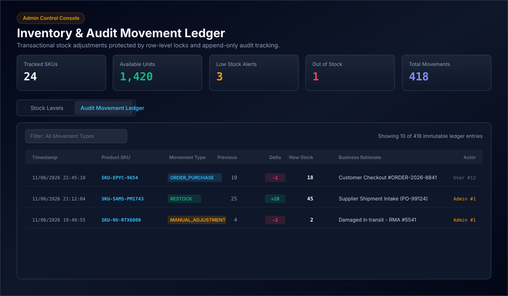

# StockGuard — High-Concurrency Inventory & Idempotent Order Engine

[](https://github.com/SyedJunaidImran/StockGuard/actions/workflows/ci.yml)
[](https://openjdk.org/projects/jdk/21/)
[](https://spring.io/projects/spring-boot)
[](https://www.postgresql.org/)
[](https://flywaydb.org/)
[](https://react.dev/)
[](https://www.typescriptlang.org/)
[](https://vitejs.dev/)
[](LICENSE)

StockGuard is a production-grade, modular monolith e-commerce platform and inventory management engine engineered to eliminate **inventory overselling, checkout race conditions, duplicate charges, and financial ledger drift under heavy concurrent traffic**.

Built with **Java 21 LTS**, **Spring Boot 3.3**, **PostgreSQL 16**, and **React 18 / TypeScript**, StockGuard provides database-engine-level transactional guarantees: row-level pessimistic write locking, deadlock-free sorted lock acquisition, database-level non-negative check constraints, RFC 4122 v4 idempotency with transaction-gap protection, an append-only immutable audit movement ledger, and immutable purchase price snapshots.

---

### Quick Links
* **GitHub Repository:** [https://github.com/SyedJunaidImran/StockGuard](https://github.com/SyedJunaidImran/StockGuard)
* **Live Frontend Demo (Vercel):** [https://stockguard.vercel.app](https://stockguard.vercel.app) *(Deployment-Ready)*
* **Live Backend API & Health Telemetry (Render):** `https://stockguard-backend.onrender.com/api/v1/health`
* **Production Deployment Guide:** [docs/DEPLOYMENT.md](docs/DEPLOYMENT.md)
* **System Architecture & Sequence Diagrams:** [docs/ARCHITECTURE.md](docs/ARCHITECTURE.md)

---

## 1. Problem Statement & Engineering Differentiators

In standard e-commerce applications, sudden traffic spikes (e.g., flash sales, limited-quantity hardware drops, or ticket releases) routinely suffer from critical failure modes:

1. **Inventory Overselling (Race Conditions):** Multiple threads read available stock simultaneously (e.g., `stock = 1`), pass application checks, and decrement stock concurrently, driving inventory negative and leaving businesses with unfulfillable commitments.
2. **Duplicate Order Placement:** Network interruptions, slow responses, or impatient users rapidly double-clicking checkout buttons trigger duplicate orders and double-charge payment methods.
3. **Database Deadlocks:** Competing multi-item orders acquiring row locks in differing arbitrary sequences create circular wait deadlocks, crashing transactions under load.
4. **Historical Price Drift:** Calculating order totals dynamically from current product tables distorts financial histories whenever catalog prices change.
5. **Auditing Gaps:** Overwriting stock counts in place without an append-only transaction ledger makes shrinkage, theft, and inventory drift impossible to trace.

### How StockGuard Solves These Challenges:

```
[Concurrent Requests] ───► [RFC 4122 Idempotency Filter]
                                    │ (Unique Key & SHA-256 Fingerprint)
                                    ▼
                           [Ascending ID Sorting] (P₁ < P₂ < ⋯ < Pₙ)
                                    │ (Deadlock Prevention)
                                    ▼
                           [SELECT ... FOR UPDATE] (Pessimistic Row Lock)
                                    │
                                    ├── Stock < Requested ──► HTTP 409 Conflict (Aborted)
                                    └── Stock >= Requested ─► Decrement Stock
                                                                │
                                                                ▼
                                                   [PostgreSQL Engine CHECK]
                                                   (available_stock >= 0)
                                                                │
                                                                ▼
                                                   [Append-Only Audit Ledger]
                                                   (inventory_movements)
```

* **Pessimistic Row Locking (`SELECT ... FOR UPDATE`):** Competitors for contested inventory rows block at the PostgreSQL database engine level until the active transaction commits.
* **Database-Level Defense-in-Depth (`CHECK (available_stock >= 0)`):** PostgreSQL enforces a hard check constraint preventing negative stock even if application logic is bypassed or corrupted.
* **Deadlock-Free Sorted Lock Acquisition:** Multi-item orders sort product IDs in ascending numerical order ($P_1 < P_2 < \dots < P_n$) before acquiring locks, mathematically eliminating circular wait conditions.
* **RFC 4122 v4 Idempotency with Transaction-Gap Protection:** Protects checkout endpoints with unique client keys, payload hashing, and terminal status immunity. Solves the transaction-boundary gap between key reservation and order execution.
* **Append-Only Immutable Audit Ledger (`inventory_movements`):** Every quantity modification writes an immutable audit record tracking previous stock, new stock, movement delta, actor ID, and business rationale.
* **Immutable Historical Price Snapshots:** `order_items` stores historical unit prices with `NUMERIC(12, 2)` precision at checkout time, decoupling past sales from future catalog modifications.

---

## 2. Key Features & Role-Based Access Control (RBAC)

### Customer Experience (`ROLE_CUSTOMER`)
* **Product Catalog & Search:** High-throughput catalog discovery with real-time multi-field search (title, description, SKU), category filter chips, and allowlisted database sorting (`createdAt`, `price`, `name`).
* **Live Stock Indicators:** Real-time stock status (**In Stock**, **Low Stock** with remaining quantity, and **Out of Stock**). Add-to-cart controls are automatically disabled when stock is zero.
* **Concurrency-Safe Shopping Cart:** Session-persisted cart with item quantity controls, optimistic subtotal estimation, and line-item management.
* **Authoritative Server Checkout:** Client submits only product IDs and desired quantities. All prices, stock subtotals, and taxes are calculated authoritatively by Spring Boot under row-level locks.
* **Idempotent Order Placement:** RFC 4122 v4 `Idempotency-Key` headers guarantee that network retries or rapid re-clicks never create duplicate orders or double-deduct warehouse stock.
* **Order History & Receipts:** Paginated customer order history with clickable receipts displaying status badges (**Confirmed**, **Processing**, **Shipped**, **Delivered**, **Cancelled**), delivery notes, and immutable purchase price snapshots.
* **Customer Ownership Isolation:** Customers can only inspect orders they personally created; accessing another customer's order returns HTTP 404/403.
* **Stateless Authentication:** User registration (strictly defaults to `ROLE_CUSTOMER`), BCrypt password hashing, and login with automatic JWT session management.

### Administrator Operations (`ROLE_ADMIN`)
* **Executive Inventory Dashboard:** 5 real-time KPI metrics tracking **Tracked SKUs**, **Available Units**, **Low Stock Alerts**, **Out of Stock**, and **Total Audit Movements**.
* **Pessimistic Stock Adjustments:** Execute instant stock modifications (**ADD** for restocks/supplier shipments, **REMOVE** for damage write-offs) with mandatory business reason logging.
* **Engine-Level Overdraft Protection:** Removals exceeding current available stock are rejected before database rows are updated.
* **Immutable Audit Movement Ledger:** Append-only ledger recording every stock transition with previous stock, new stock, movement delta pills (`+50`, `-2`), actor attribution, and business rationale.
* **Product Catalog CRUD:** Create new products with SKU codes and category mappings, update pricing and descriptions, and toggle active/inactive status.
* **Role-Guarded Security:** Administrative endpoints (`/api/v1/admin/**`) are strictly enforced at the Spring Security filter chain and method level via `@PreAuthorize("hasRole('ADMIN')")`.

---

## 3. Screenshots & Visual Interface Walkthrough

StockGuard features a custom dark enterprise SaaS user interface with live telemetry, stock indicators, and administrative consoles.

| Real-Time Hardware Catalog & Live Stock | Concurrency-Safe Cart & Idempotency Indicator |
|:---:|:---:|
| <br/>*Real-time catalog with dynamic search, category chips, and live stock badges.* | <br/>*Cart with item quantity controls, duplicate order protection banner, and estimate summary.* |

| Customer Order History & Snapshot Ledger | Admin Inventory Overview & Immutable Audit Ledger |
|:---:|:---:|
| <br/>*Clickable order history with status badges, delivery notes, and immutable price snapshots.* | <br/>*Admin KPI cards, pessimistic stock adjustment modal, and append-only movement ledger.* |

> [!TIP]
> Vector SVG mockups are bundled in `docs/screenshots/`. Live desktop PNG screenshots captured from `http://localhost:5173` can drop into `docs/screenshots/` with matching filenames.

---

## 4. Technology Stack

### Backend Architecture
- **Language & Runtime:** Java 21 LTS (Eclipse Temurin / OpenJDK).
- **Framework:** Spring Boot 3.3.4 (Modular Monolith).
- **Persistence & ORM:** Spring Data JPA / Hibernate 6 with HikariCP connection pooling.
- **Database Engine:** PostgreSQL 16 (Local, Docker Compose, or hosted cloud on **Supabase** via direct/session pooler mode).
- **Schema Evolution:** Flyway version-controlled migrations (`V1__initial_schema.sql` through `V4`).
- **Security:** Spring Security 6, BCrypt password hashing, stateless JJWT (`io.jsonwebtoken 0.12.6`).
- **Idempotency & Concurrency:** Pessimistic locking (`LockModeType.PESSIMISTIC_WRITE`), RFC 4122 v4 keys, SHA-256 payload hashing.
- **Testing:** JUnit 5, Mockito, Spring Boot MockMvc, Testcontainers PostgreSQL 16.

### Frontend Architecture
- **Framework & Language:** React 18 SPA with TypeScript 5.5.
- **Tooling & Build:** Vite 5.4.
- **Styling & Design System:** Custom dark enterprise design system with vanilla CSS tokens (zero heavy CSS runtime bloat).
- **Icons & Visuals:** `lucide-react`, hardware silicon circuit die SVG fallbacks for missing/broken product images.
- **HTTP Client:** Native `fetch` with centralized interceptor, JWT Bearer auto-injection, and typed `ApiError` envelopes.

---

## 5. System Architecture & Modular Monolith Design

StockGuard adheres to a clean **Modular Monolith** architecture with strict domain boundaries:

```
StockGuard/
├── backend/                              # Spring Boot 3 & Java 21 Application
│   ├── src/main/java/com/stockguard/
│   │   ├── auth/                         # Authentication, UserAccountInitializer & RBAC controllers
│   │   ├── catalog/                      # Public products, categories, allowlisted sorting & search
│   │   ├── common/                       # Centralized ApiResponse<T>, GlobalExceptionHandler, CORS
│   │   ├── health/                       # Telemetry probe: DB connection latency, memory, uptime
│   │   ├── inventory/                    # Row locking, stock adjustments, immutable movement ledger
│   │   ├── order/                        # Concurrency order placement, IdempotencyService, snapshots
│   │   ├── security/                     # JJWT filter, UserPrincipal, SecurityConfig
│   │   └── user/                         # User accounts, BCrypt passwords, Role enum (CUSTOMER, ADMIN)
│   ├── src/main/resources/
│   │   ├── application.yml               # Base application profile
│   │   ├── application-dev.yml           # Dev profile (PostgreSQL / Flyway)
│   │   ├── application-prod.yml          # Production profile (Render 512MB / Supabase pooler)
│   │   ├── application-test.yml          # Test profile (H2 in-memory compatibility)
│   │   └── db/migration/                 # Flyway migrations (V1 initial schema through V4)
│   └── src/test/java/com/stockguard/     # 114 Unit, slice, and PostgreSQL integration tests
├── frontend/                             # React 18 + Vite + TypeScript Application
│   ├── src/
│   │   ├── components/                   # Navbar, ProductCatalog, Inventory, Cart, Orders, Auth
│   │   ├── context/                      # AuthContext (JWT session), CartContext (local persistence)
│   │   ├── services/                     # Typed API client services (auth, product, inventory, order)
│   │   └── types/                        # TypeScript interfaces mirroring backend DTOs
│   ├── vercel.json                       # SPA rewrite rules for Vercel edge deployment
│   ├── index.html
│   └── package.json
├── docs/                                 # Engineering documentation
│   ├── ARCHITECTURE.md                   # System design, Mermaid sequence diagrams & state machines
│   ├── DATABASE_SCHEMA.md                # Relational entity definitions, constraints & index strategy
│   ├── DEPLOYMENT.md                     # Complete cloud deployment guide (Supabase, Render, Vercel)
│   ├── ROADMAP.md                        # Multi-phase engineering roadmap & milestone tracker
│   └── TESTING.md                        # Test suite documentation & 7 PostgreSQL concurrency scenarios
├── infra/                                # Local Docker Compose PostgreSQL 16 setup
├── .github/workflows/ci.yml              # GitHub Actions CI pipeline (Node 22, H2 Tests, Postgres 16)
├── render.yaml                           # Render Blueprint web service configuration
└── .env.example                          # Environment variable configuration template
```

---

## 6. Core Concurrency & Idempotency Implementation

### 1. Deadlock-Free Pessimistic Row Locking
```java
// Sort product IDs in ascending numerical order to break circular wait deadlocks
List<Long> sortedProductIds = request.getItems().stream()
        .map(OrderItemRequest::getProductId)
        .distinct()
        .sorted()
        .toList();

for (Long productId : sortedProductIds) {
    Inventory inventory = inventoryRepository.findByProductIdWithLock(productId)
            .orElseThrow(() -> new ResourceNotFoundException("Inventory not found for product " + productId));
    
    if (inventory.getAvailableStock() < requestedQty) {
        throw new InsufficientStockException("Insufficient stock for product: " + inventory.getProductName());
    }
    inventory.setAvailableStock(inventory.getAvailableStock() - requestedQty);
}
```

### 2. Transaction-Gap Race Condition Resolution
StockGuard resolves the subtle window between reserving an idempotency key and executing order placement by acquiring an immediate row lock on the idempotency record inside `executeOrderPlacement()`:
```java
IdempotencyRecord activeRecord = idempotencyService.lockActiveRecord(idempotencyKey);

// If a retry thread completed the order during a stalled window, return cached response immediately
if (activeRecord.getStatus() == IdempotencyStatus.COMPLETED && activeRecord.getCachedResponse() != null) {
    return objectMapper.readValue(activeRecord.getCachedResponse(), OrderResponse.class);
}
```
This guarantees that stale or superseded threads exit early before any inventory row lock is requested or stock is deducted.

---

## 7. REST API Endpoint Overview

All API responses follow a standardized `ApiResponse<T>` envelope containing `success`, `message`, `data`, and ISO 8601 `timestamp`.

### Public Endpoints
| Method | Path | Description | Authentication |
|---|---|---|---|
| `GET` | `/api/v1/health` | Health probe: DB connection latency, memory, uptime | None |
| `POST` | `/api/v1/auth/register` | Register a new customer account (always `ROLE_CUSTOMER`) | None |
| `POST` | `/api/v1/auth/login` | Authenticate credentials and receive Bearer JWT | None |
| `GET` | `/api/v1/products` | Paginated product catalog (search, filter, sort) | None |
| `GET` | `/api/v1/products/{id}` | Get product details by ID | None |
| `GET` | `/api/v1/categories` | List all catalog categories | None |

### Customer Endpoints
| Method | Path | Description | Authentication |
|---|---|---|---|
| `POST` | `/api/v1/orders` | Concurrency-safe order checkout (`Idempotency-Key` header) | `ROLE_CUSTOMER` |
| `GET` | `/api/v1/orders/my-orders` | Paginated order history for authenticated customer | `ROLE_CUSTOMER` |
| `GET` | `/api/v1/orders/{id}` | Get order details with line item price snapshots | Customer (Owner) or Admin |

### Admin Endpoints
| Method | Path | Description | Authentication |
|---|---|---|---|
| `POST` | `/api/v1/admin/products` | Create a new catalog product | `ROLE_ADMIN` |
| `PUT` | `/api/v1/admin/products/{id}` | Update product metadata or pricing | `ROLE_ADMIN` |
| `PATCH`| `/api/v1/admin/products/{id}/status` | Activate or deactivate product in catalog | `ROLE_ADMIN` |
| `GET` | `/api/v1/admin/inventory` | Paginated stock levels across all catalog products | `ROLE_ADMIN` |
| `GET` | `/api/v1/admin/inventory/{id}` | Get stock levels for a specific product | `ROLE_ADMIN` |
| `POST` | `/api/v1/admin/inventory/{id}/adjustments`| Execute pessimistic stock adjustment (`ADD` / `REMOVE`) | `ROLE_ADMIN` |
| `GET` | `/api/v1/admin/inventory/movements`| Paginated immutable global audit movement ledger | `ROLE_ADMIN` |

---

## 8. Local Installation & Setup Instructions

### Prerequisites
- **Java Development Kit (JDK):** Version 21 LTS (Eclipse Temurin / OpenJDK).
- **Node.js:** Version 20 LTS or 22 LTS with `npm`.
- **Database:** PostgreSQL 15+ (Local instance, Docker Compose, or hosted Supabase).
- **Maven:** Bundled via `./mvnw` (Linux/macOS) or `.\mvnw.cmd` (Windows).

### Step 1: Clone Repository
```bash
git clone https://github.com/SyedJunaidImran/StockGuard.git
cd StockGuard
```

### Step 2: Configure Environment Variables
Copy `.env.example` to `.env` in the root directory:
```bash
# Windows PowerShell
Copy-Item .env.example .env

# Linux / macOS
cp .env.example .env
```
Ensure your database connection details match your local PostgreSQL instance:
```ini
SPRING_DATASOURCE_URL=jdbc:postgresql://localhost:5432/stockguard
SPRING_DATASOURCE_USERNAME=postgres
SPRING_DATASOURCE_PASSWORD=postgres
JWT_SECRET=stockguard_default_dev_secret_key_replace_in_production_32chars!
VITE_API_BASE_URL=http://localhost:8080/api/v1
```

### Step 3: Start PostgreSQL (Docker Option)
If you have Docker installed:
```bash
docker compose -f infra/docker-compose.yml up -d
```
Alternatively, create a database named `stockguard` in your native PostgreSQL server. Flyway will automatically execute migrations and seed catalog categories on startup.

### Step 4: Run the Backend
```bash
# Windows
cd backend
.\mvnw.cmd spring-boot:run

# Linux / macOS
cd backend
./mvnw spring-boot:run
```
The backend initializes on `http://localhost:8080`. Verify the health probe:
```bash
curl http://localhost:8080/api/v1/health
```

### Step 5: Run the Frontend
In a separate terminal:
```bash
cd frontend
npm install
npm run dev
```
Open `http://localhost:5173` in your browser.

### Demo Credentials & Access
- **Customer Demo (Public / Recruiters):** `customer@stockguard.io` / `Customer123!` (or click **Quick Fill Demo Account** in the UI).
- **Administrator Console:** Administrator access is restricted and configured server-side via environment variables (`STOCKGUARD_ADMIN_EMAIL` and `STOCKGUARD_ADMIN_PASSWORD`). Admin credentials are never hardcoded or exposed in public client bundles.

---

## 9. Testing & Quality Assurance

StockGuard includes comprehensive unit, slice, and live PostgreSQL integration test suites:

```bash
# Run backend unit and slice tests (H2 in-memory profile - 114 tests)
cd backend
./mvnw test -Dtest="!PostgresIntegrationTest"

# Run PostgreSQL 16 integration tests (Docker / Testcontainers - 7 high-concurrency scenarios)
./mvnw test -Dtest=PostgresIntegrationTest

# Run frontend TypeScript type-check and Vite production build
cd frontend
npm run build
```

### The 7 PostgreSQL Concurrency & Security Scenarios:
1. **10 Concurrent Customer Orders for 3 Units:** Exactly 3 orders succeed, 7 receive 409 Conflict, stock ends at exactly 0. Zero overselling.
2. **5 Simultaneous Requests with Identical Idempotency-Key:** Exactly 1 order created, 1 stock deduction, all 5 receive identical response.
3. **Multi-Item Transaction Rollback:** Atomic failure on item 2 rolls back item 1 with zero partial records.
4. **Inventory Movement Ledger Consistency:** Audit records match stock deltas 1:1 with actor attribution.
5. **Security, RBAC & Customer Ownership:** Customer tokens cannot view other customers' orders or access admin routes.
6. **Stalled PROCESSING & FAILED Recovery:** Crashed requests are safely recovered by retries after the 2-minute timeout.
7. **Transaction-Gap Concurrency Race Elimination:** Delayed original requests detect completed state and exit early without double stock deduction.

See [docs/TESTING.md](docs/TESTING.md) for full scenario walkthroughs and CI setup.

---

## 10. Deployment Architecture & Cloud Strategy

> [!NOTE]
> **Deployment Status: DEPLOYMENT-READY.**
> StockGuard is verified through local development testing and GitHub Actions CI with live PostgreSQL 16 integration tests. Cloud deployment configurations ([`render.yaml`](render.yaml), [`frontend/vercel.json`](frontend/vercel.json), and [`docs/DEPLOYMENT.md`](docs/DEPLOYMENT.md)) are fully prepared and ready for provisioning on Supabase, Render, and Vercel.

### Production Cloud Topology:
* **Managed Database:** Hosted PostgreSQL 16 on **Supabase** with connection pooling (HikariCP tuned for Supavisor session mode on Port 5432) and SSL enforcement (`sslmode=require`).
* **Backend Application:** Multi-stage Eclipse Temurin 21 Docker Web Service on **Render** (cgroup memory safety caps: `MaxRAMPercentage=60.0`, `Xss512k`, non-root execution, and health probes via `/api/v1/health`).
* **Frontend Client:** Single Page Application (SPA) production build hosted on **Vercel** with edge CDN caching and SPA rewrite configuration (`frontend/vercel.json`).
* **Secrets Management:** Cloud-injected environment variables for 256-bit HMAC-SHA JWT secrets, database credentials, and production CORS origins.

For complete step-by-step instructions, see the [Production Deployment Guide](docs/DEPLOYMENT.md).

---

## 11. Project Roadmap & Milestone Tracker

| Milestone | Scope | Status |
|---|---|---|
| **Phase 1: Foundations** | Monorepo setup, Spring Boot 3 + Java 21, Flyway V1 schema, Health probe, React + Vite UI | **Completed** |
| **Phase 2: Auth & Security** | BCrypt password hashing, stateless JJWT filter, Register/Login, Role-based guards (`CUSTOMER`, `ADMIN`) | **Completed** |
| **Phase 3: Catalog & Products** | Real-time product catalog, dynamic multi-field search, category filtering, allowlisted sorting, pagination, admin CRUD | **Completed** |
| **Phase 4: Inventory Engine** | Available & reserved stock tracking, row locks, administrative adjustments (ADD/REMOVE), immutable audit ledger | **Completed** |
| **Phase 5: Concurrency & Orders** | Concurrency-safe customer order checkout, pessimistic row locks, cart persistence, price snapshots, ownership isolation | **Completed** |
| **Phase 6: PostgreSQL & Idempotency** | Idempotency keys, transaction-gap race condition elimination, stalled/failed recovery, Testcontainers integration harness | **Completed** |
| **Phase 7: PostgreSQL CI Verification** | Execute GitHub Actions workflow with live PostgreSQL 16 container verifying all 7 concurrency integration scenarios | **Completed** *(All 7 scenarios green)* |
| **Phase 8: Production Deployment** | Cloud infrastructure configuration (Render / Supabase / Vercel), environment secrets, SSL termination, CDN distribution | **Deployment-Ready** ([Guide](docs/DEPLOYMENT.md)) |
| **Phase 9: Live Testing & Portfolio** | Production smoke verification, live telemetry validation, architecture walkthrough, and portfolio presentation | *Planned* |

See [docs/ROADMAP.md](docs/ROADMAP.md) for full phase-by-phase engineering deliverables and architectural rationale.

---

## 12. Documentation Directory

For detailed engineering references, explore the dedicated documentation suite:
* **[docs/ARCHITECTURE.md](docs/ARCHITECTURE.md):** Modular monolith domain boundaries, Mermaid sequence diagrams, ER entity diagrams, and lock ordering.
* **[docs/DEPLOYMENT.md](docs/DEPLOYMENT.md):** Production cloud deployment manual covering Supabase connection modes, Render Docker backend, and Vercel frontend.
* **[docs/TESTING.md](docs/TESTING.md):** In-memory H2 suite, Testcontainers dynamic discovery, and detailed walkthroughs of all 7 PostgreSQL concurrency scenarios.
* **[docs/ROADMAP.md](docs/ROADMAP.md):** Complete 9-phase development history, current statuses, and future milestones.
* **[docs/DATABASE_SCHEMA.md](docs/DATABASE_SCHEMA.md):** Relational tables, Flyway migrations, check constraints, and index optimizations.
* **[docs/screenshots/README.md](docs/screenshots/README.md):** Visual UI preview assets and screenshot capture guidelines.

---

## 13. License

This project is licensed under the MIT License — see the [LICENSE](LICENSE) file for details.
