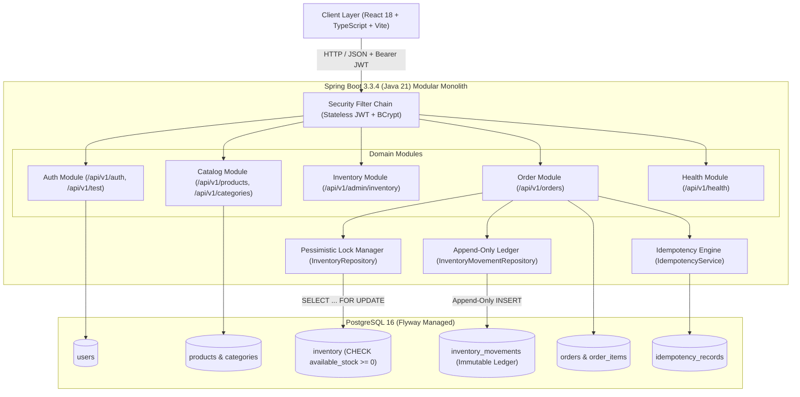
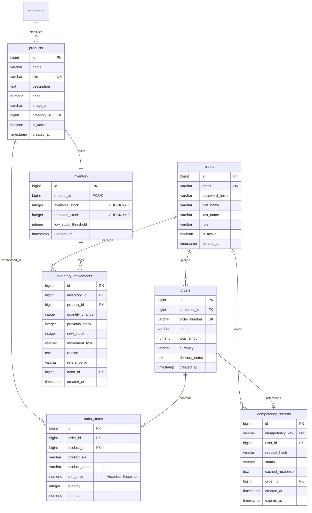
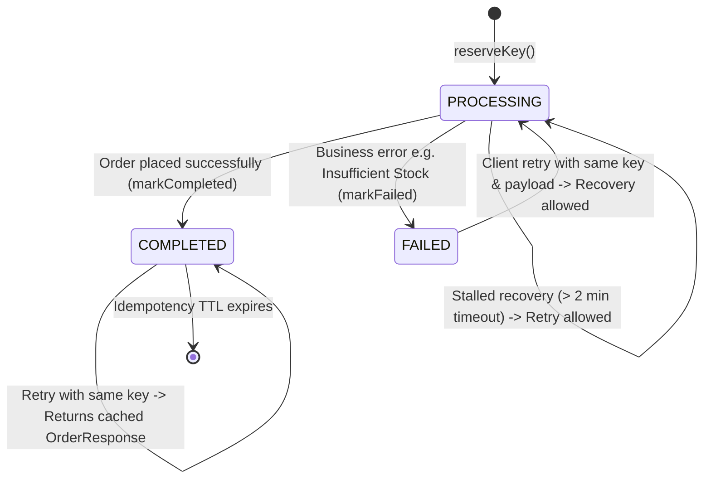
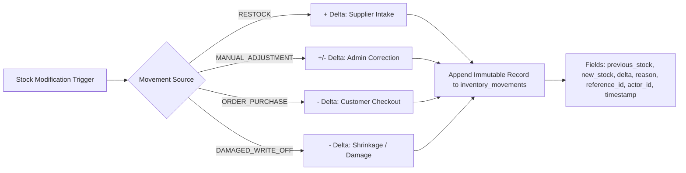
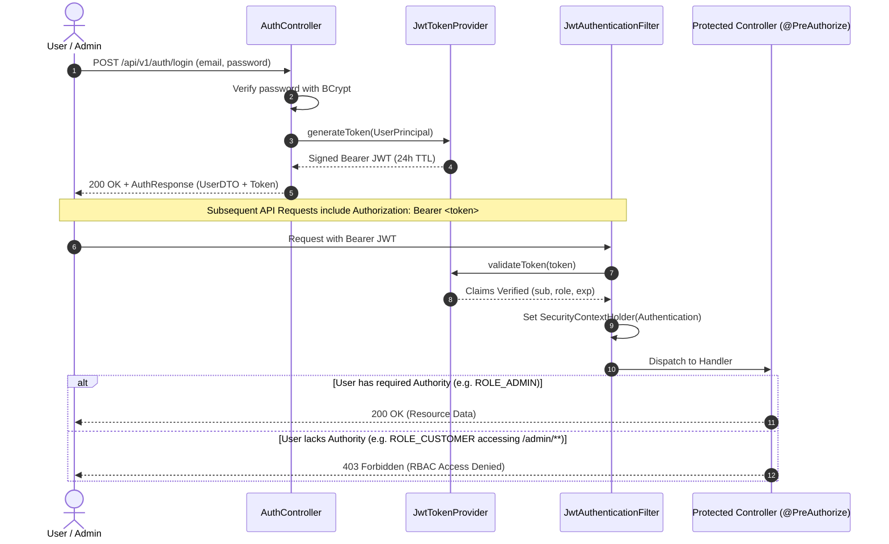

# StockGuard — System Architecture & Concurrency Design

This document details the architectural principles, domain module boundaries, database relationships, concurrency controls, idempotency lifecycle, and audit guarantees powering **StockGuard**.

---

## 1. High-Level Architecture Overview

StockGuard is architected as a **Modular Monolith** designed around strict domain boundaries. It decouples high-throughput public catalog browsing from transactional inventory writes and order settlements.



---

## 2. Backend Module Responsibilities

| Module | Package | Responsibility | Primary Entities | Security Boundary |
|---|---|---|---|---|
| **Auth** | `com.stockguard.auth`, `com.stockguard.user` | User registration, login, BCrypt hashing, stateless JJWT creation, and user principal resolution. | `User`, `Role` | Public registration/login; RBAC tests guarded by `@PreAuthorize`. |
| **Catalog** | `com.stockguard.catalog` | Public product discovery, category hierarchical filters, multi-field search, pagination, and admin product CRUD. | `Product`, `Category` | Public reads (`GET /products`); Admin-only mutations (`POST/PUT /admin/products`). |
| **Inventory** | `com.stockguard.inventory` | Stock tracking, low-stock threshold evaluation, row-level pessimistic locking, stock adjustments (ADD/REMOVE), and audit logging. | `Inventory`, `InventoryMovement` | Strictly restricted to `ROLE_ADMIN` (`/api/v1/admin/inventory/**`). |
| **Order** | `com.stockguard.order` | High-concurrency order placement, RFC 4122 v4 idempotency validation, stock reservation, and price snapshotting. | `Order`, `OrderItem`, `IdempotencyRecord` | Restricted to `ROLE_CUSTOMER` for order creation; cross-customer ownership enforced. |
| **Health** | `com.stockguard.health` | System health probe, PostgreSQL connection latency telemetry, memory usage, and uptime metrics. | N/A | Public (`/api/v1/health`). |
| **Common** | `com.stockguard.common`, `com.stockguard.security` | Centralized exception handling, standard `ApiResponse<T>` envelope, CORS filter, and JWT authentication filter. | N/A | Global infrastructure. |

---

## 3. Database Relational Entity Model



---

## 4. High-Concurrency Order Placement Flow

When a customer checks out, the request passes through idempotency validation, pessimistic row lock acquisition, available stock validation, atomic deduction, immutable ledger entry, and price snapshotting inside a single atomic transaction.

```mermaid
sequenceDiagram
    autonumber
    actor Customer as Customer Client
    participant Controller as OrderController
    participant IdemService as IdempotencyService
    participant OrderService as OrderService
    participant InvRepo as InventoryRepository
    participant DB as PostgreSQL 16 Engine

    Customer->>Controller: POST /api/v1/orders (Payload + Idempotency-Key)
    Controller->>IdemService: reserveKey(key, userId, requestHash)
    
    alt Key already COMPLETED
        IdemService-->>Controller: Return Cached OrderResponse
        Controller-->>Customer: 200 OK (Cached Response)
    else Key active PROCESSING (< 2 min timeout)
        IdemService-->>Controller: 409 Conflict ("In-Flight Concurrent Request")
        Controller-->>Customer: 409 Conflict
    else Key New or Stalled/Failed (> 2 min timeout)
        IdemService->>DB: INSERT / UPDATE status='PROCESSING'
        IdemService-->>Controller: Proceed to Order Execution
    end

    Controller->>OrderService: createOrder(request, userId, idempotencyKey)
    
    rect rgb(20, 30, 50)
        Note over OrderService,DB: Spring @Transactional (executeOrderPlacement)
        OrderService->>IdemService: lockActiveRecord(key)
        
        alt Another thread completed during transaction boundary gap
            IdemService-->>OrderService: Return Cached Order
            OrderService-->>Controller: Early Exit (Zero Stock Deduction)
        else Row lock acquired on IdempotencyRecord
            IdemService-->>OrderService: Confirmed in-flight execution
        end

        Note over OrderService: Sort Product IDs ascending to prevent Deadlocks
        OrderService->>InvRepo: findByProductIdWithLock(productId)
        InvRepo->>DB: SELECT * FROM inventory WHERE product_id = ? FOR UPDATE
        DB-->>OrderService: Row-Level Exclusive Lock Acquired

        alt available_stock < requested_quantity
            OrderService->>IdemService: markFailed(key, error)
            OrderService-->>Controller: 409 Conflict ("Insufficient stock")
            Note over DB: Transaction Rollback (No stock deducted)
        else available_stock >= requested_quantity
            OrderService->>DB: UPDATE inventory SET available_stock = available_stock - qty
            OrderService->>DB: INSERT INTO inventory_movements (ORDER_PURCHASE delta)
            OrderService->>DB: INSERT INTO orders & order_items (Snapshot unit_price)
            OrderService->>IdemService: markCompleted(key, orderResponse)
            IdemService->>DB: UPDATE idempotency_records SET status='COMPLETED', cached_response=?
            Note over DB: Transaction Commit
            OrderService-->>Controller: Created OrderResponse
            Controller-->>Customer: 201 Created (Order Placed)
        end
    end
```



---

## 5. Inventory Locking Mechanism & Deadlock Elimination

### A. Pessimistic Row Locking (`PESSIMISTIC_WRITE`)
StockGuard enforces serializable isolation for contested inventory rows using JPA `LockModeType.PESSIMISTIC_WRITE`, translated into PostgreSQL:
```sql
SELECT id, product_id, available_stock, reserved_stock, low_stock_threshold, updated_at
FROM inventory
WHERE product_id = ?
FOR UPDATE;
```
Any competing thread attempting to checkout the same item is blocked at the database engine level until the current transaction commits or rolls back.

### B. Deadlock Elimination via Sorted Lock Acquisition
When an order contains multiple line items (e.g., Product #12 and Product #3), competing concurrent orders could deadlock if thread A locks #12 then #3, while thread B locks #3 then #12.

StockGuard eliminates deadlocks by **strictly sorting product IDs in ascending numerical order** before acquiring locks:
```java
List<Long> sortedProductIds = request.getItems().stream()
        .map(OrderItemRequest::getProductId)
        .distinct()
        .sorted()
        .toList();

for (Long productId : sortedProductIds) {
    Inventory inventory = inventoryRepository.findByProductIdWithLock(productId)
            .orElseThrow(() -> new ResourceNotFoundException("Inventory not found for product " + productId));
    // Verify and deduct stock...
}
```
Because all threads acquire row locks in the identical global order ($P_1 < P_2 < \dots < P_n$), circular wait conditions are mathematically impossible.

### C. Defense-in-Depth Engine Constraint
At the database schema level, `V1__initial_schema.sql` enforces:
```sql
CONSTRAINT chk_inventory_available_stock_non_negative CHECK (available_stock >= 0)
```
Even if application logic were corrupted or bypassed, the PostgreSQL storage engine aborts any transaction resulting in negative stock with a check constraint violation (`23514`), guaranteeing zero overselling under all conditions.

---

## 6. Idempotency Lifecycle & Transaction-Gap Race Condition Fix

### A. Idempotency State Machine



### B. The Transaction-Gap Race Condition Resolution
During Phase 6 testing, a subtle concurrency vulnerability was identified in the transaction boundary between:
1. `reserveKey()`: Commits a new `PROCESSING` record in Transaction 1 (`REQUIRES_NEW`).
2. `executeOrderPlacement()`: Starts Transaction 2 and acquires inventory locks.

**The Race Scenario:**
If Request 1 stalled for > 2 minutes after Step 1, Request 2 with the identical key could enter via stalled recovery, complete order placement, deduct stock, and commit `COMPLETED`. If Request 1 subsequently resumed execution, it could proceed to deduct stock a second time.

**The Architectural Fix:**
StockGuard implements `lockActiveRecord(key)` at the immediate start of `executeOrderPlacement()` under `PESSIMISTIC_WRITE`:
```java
// Acquire row-level lock on the idempotency record inside executeOrderPlacement transaction
IdempotencyRecord activeRecord = idempotencyService.lockActiveRecord(idempotencyKey);

// If another thread completed the order during the gap, return the cached response immediately
if (activeRecord.getStatus() == IdempotencyStatus.COMPLETED && activeRecord.getCachedResponse() != null) {
    return objectMapper.readValue(activeRecord.getCachedResponse(), OrderResponse.class);
}
```
- **Early Return Before Write:** The early return executes *prior* to any inventory lookup, row locking, stock deduction, or ledger entry.
- **Downgrade Immunity:** `markFailed()` and `markCompleted()` enforce terminal state immunity—an already `COMPLETED` record can never be overwritten or downgraded by a stale transaction.

---

## 7. Append-Only Inventory Movement Audit Ledger

Every physical inventory change is recorded in `inventory_movements`. The table is strictly **append-only**: no `UPDATE` or `DELETE` statements are ever executed against it.



---

## 8. Stateless Authentication & Authorization Architecture

StockGuard uses stateless JSON Web Tokens (JWT) signed with HMAC-SHA256 (`HS256`). Tokens carry user identity (`sub`) and role authority (`role`).



---

## 9. Deployment Architecture

StockGuard is designed for low-cost, zero-maintenance cloud hosting using managed free-tier platforms:

```mermaid
graph LR
    subgraph Edge["Client Edge"]
        Vercel["Frontend (Vercel / Netlify CDN)<br/>React 18 + Vite SPA"]
    end

    subgraph Compute["Application Tier"]
        Render["Backend Service (Render.com Web Service)<br/>Docker / Java 21 OpenJDK LTS"]
    end

    subgraph DataTier["Data Tier"]
        Supabase["PostgreSQL 16 (Supabase / AWS us-east-1)<br/>Flyway Managed + HikariCP Connection Pool"]
    end

    Vercel -->|HTTPS REST API / JSON| Render
    Render -->|JDBC (SSL Enabled) Connection Pool (HikariCP max-pool=5)| Supabase
```

